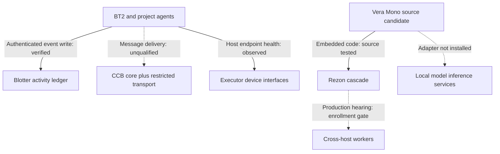

# BT2 ecosystem integration ledger — 2026-10-24

Status: **active, partial source repairs; no global operational qualification**.
Owner/coordinator: BT2 One. Canonical ledger branch proposed against
`thebrazenbeard/bt2@ba830cc2914813c3b4e76751f77b1cf3a132a5c4`.
This document is public-safe. Restricted repository identity and private
review details are intentionally excluded and must stay in permitted
private records.

## Evidence vocabulary

- **SOURCE** — exact Git branch/commit, not merged or installed.
- **BUILD/TEST** — exact-head automated/local tests, not real effects.
- **INSTALL** — a specific installed tree and version read back.
- **RUNTIME** — a service/process observed on a particular host.
- **E2E** — a real workflow with both endpoints and effects read back.
- **UNKNOWN** — insufficient permitted evidence. Internal/model review
  never upgrades one of the above classes.

## Public owner inventory and dependency boundaries

Owner-scoped public discovery identified 78 public repositories. The [public repository role inventory](PUBLIC_REPOSITORY_ROLE_INVENTORY_20261024.md) names all 78 and classifies them from current README/metadata only; its repository-specific installation and runtime states are UNKNOWN. An
exact Git-blob scan found a concealed VS Code `folderOpen` task and
disguised Node executable in **45 of those 78** public repositories,
across two observed asset variants. The affected checkout is a
**conditional startup exposure**, not evidence that the command ever
executed on a workstation. Additional access-restricted inventory
exists; neither counts nor identities are published here.

| Component | Responsibility | Actual connection or boundary | State |
| --- | --- | --- | --- |
| `vera-mono` | Canonical assembled Vera code: 12 Python package roots, persistent governance/recovery | Models, devices, databases and transports remain separately admitted external services | SOURCE and BUILD verified; restricted install/runtime readback is mismatched and not qualified |
| `rezon` | Multi-model reasoning and worker hearings | External repo is a donor/worker infrastructure; absorbed `packages/rezon` is internal to Mono | Test harness exists; production credential enrollment incomplete |
| `ccb-core` | Public reusable Bus/Radar production source and protocol tests | Deployment and private writer-lane overlays are external to reusable source | README source authority verified; deployed provider/version and delivery receipts unqualified |
| Restricted Bus transport | Non-PR agent messaging and private lane state | Shared coordination route is distinct from PR activity, Blotter events, and model reasoning | Whole-path current delivery qualification not established here |
| `blotter` | Agent event and effect/claim journaling | Authenticated restricted operator event endpoint; events must not be mistaken for independently verified effects | Restricted authenticated event recording verified |
| `executor`, `portal`, local devices | Authenticated execution and host/service interfaces | Devices require per-host connection, explicit capability and authority; no assumed implicit tunnel | Restricted execution path observed; cross-machine aggregate E2E UNKNOWN |
| `hc-brain` and AGI research documents | Hyperconnectome cognitive-organ design and evaluation contracts | Conceptual design/qualification evidence, not proof of a running organ or AGI | DOCUMENTED, not INSTALLED |
| Product/research repos | Other independent research or business domains | Use Bus/Blotter when coordination is justified; do not invent runtime dependency on Vera | Deliberately isolated unless tested interface warrants integration |

### Integration edges — observed versus absent

Solid arrows mean only the named limited evidence was observed; dashed arrows are proposed/missing runtime contracts. No edge alone proves effect authorization or whole-system installation. Independent product/research repositories stay isolated until a justified, executed interface is demonstrated.

The 45/78 finding is an exact-blob **SOURCE** scan, not a host
probe. Its [immutable public source manifest](PUBLIC_VSCODE_TASK_EXPOSURE_MANIFEST_20261024.md)
binds all 78 public repositories to their individual `main` HEAD
commits and task-blob identities at this snapshot: 41 match one concealed
Node loader variant, 4 match a second, 26 have nonmatching task files,
and 7 lack that path. The suspicious asset was present at each affected
pinned source head. No asset was executed, and current main/host status
may differ from the pinned snapshot.

### Public main source-head bindings at this checkpoint

| Repository | Main commit |
| --- | --- |
| `bt2` | `ba830cc2914813c3b4e76751f77b1cf3a132a5c4` |
| `vera-mono` | `64c4a756a8c4d6fc791787de80303f7ee0f64869` |
| `rezon` | `d27da3cab31ae96aff3c65385fc31354dc8aeb8c` |
| `blotter` | `2493b354488cefe4a3f0d2b80372b93c6b1cfeb4` |
| `portal` | `6b601b8b291bd59cd79bcc1a96befab50ec2ebda` |
| `vera-mesh` | `3242f72a0c4b9cb53679563c78f66528841296f5` |
| `vera-control-plane` | `0654b4a646f2168b672f4f78cef71e33bc79d643` |

All implementation PRs cited below are **draft and unmerged**;
none is an installation receipt. Source/change ownership is BT2 One
or the named independent specialist; merge/legal attestations remain
with Patrick and any repository-specific protected workflow.

## Verified source repairs and exact subjects

| Subject | Defect and minimum repair | Source head / tests | Install/runtime/effect |
| --- | --- | --- | --- |
| `vera-mono` [PR #88](https://github.com/thebrazenbeard/vera-mono/pull/88) | Remove hidden editor-startup task and disguised asset; correct ineffective workspace consent claim; add source test | `ba8fab6a4f24e4f0992f98c32970ba18dd07cfcb`; GitHub monorepo CI `40103160683` PASS | Draft; not merged, installed, or host-verified |
| `vera-mono` [PR #96](https://github.com/thebrazenbeard/vera-mono/pull/96) | `pip --target` generated console entrypoint omitted target from Python import path; package a self-locating launcher inside the wheel | `590639f3c745a3bbba3ba6de2f18df594a048154`; local 641 tests + 35 subtests PASS, wheel staged and launcher executed; Windows/Ubuntu CI `40105742775` and dependency review `40105742815` PASS | Draft; portable candidate built/tested, not installed into the governed target runtime |
| `vera-mono` [PR #97](https://github.com/thebrazenbeard/vera-mono/pull/97) | Local Ollama to Rezon **unverified candidate observation** via bounded loopback transport; malformed HTTP fails closed; synthetic reviewer remains unqualified | `93d65ce87609e05e354acb0f0068db96a4977670`; local 658 tests + 35 subtests PASS; Windows/Ubuntu CI `40108548034` and dependency review `40108548021` PASS; internal independent source review PASS | Draft; no live adapter host installation or real integrated model/effect qualification. Protected staging request denied. |
| `vera-mono` [PR #98](https://github.com/thebrazenbeard/vera-mono/pull/98) | Embedded Rezon cascade incorrectly marked below-threshold answers resolved when layers/iteration budget exhausted; fail-closed gate and no-dispatch tests | `4ea394a1b24e2a7bcb382d89eb3b77b88ec74214`; original red reproductions, local 642 tests + 35 subtests PASS; GitHub monorepo and dependency review CI PASS; independent exact-head source review PASS | Draft; unmerged; no deployed effect; does not establish separately hosted Rezon defect |
| `vera-mono` [PR #99](https://github.com/thebrazenbeard/vera-mono/pull/99) | Consolidate PR #88/#96/#97/#98 plus bounded semantic preflight; reconcile PR #97's obsolete assertion about unresolved candidate persistence and correct combined module documentation | `835cabe3b93a74360c5d0d672e7d3463dd797c45` / exact Git tree `f77ee738ed7d07d49d6d38abc44a9e9653bb0d5b`; full integrated local 667 tests + 35 subtests PASS, one existing collection warning; independent source review PASS and 9 remote blobs match locally tested tree; Dependency Review PASS and Windows/Ubuntu monorepo CI `40132646910` PASS (including wheel build/installed-launcher checks) | Draft; unmerged/uninstalled; no actual adapter-on-host or independently observed model-to-action E2E |
| `rezon` [PR #119](https://github.com/thebrazenbeard/rezon/pull/119) | Linux Secret Service fallback test could use an unlocked real keyring; isolate service path with a mocked fail-closed regression | `33cba8c8b9112953f6279639755605d95499d2ae`; GitHub kernel/benchmark tests PASS | Draft; no credential enrollment or production hearing |
| `vera-control-plane` [PR #156](https://github.com/thebrazenbeard/vera-control-plane/pull/156) | Remove concealed `folderOpen` executable, misleading editor settings, add unconditional path/blob guard | `3021e3ddd8cdb8882517ba914a3403004caacb84`; source guard CI `40107264453` PASS, independent internal source review PASS | Draft; not installed; general VCP integrity CI `40107264376` FAILS 6 historical Git-object tests (260 passed, 9 subtests) |
| `tattler` [PR #17](https://github.com/thebrazenbeard/tattler/pull/17) | Remove concealed VS Code folder-open Node loader and disguised asset; source regression guard wired to CI | `e168585380acb94bd8d97487aa761e1b9ebdc94b`; local 20 Python tests PASS and independent source review PASS; Dependency Review PASS. Full build `40133858546` FAIL at pre-existing external SPK verifier Git-tree pin (the same step fails on unchanged main `40133815626`); other reported build/test steps passed | Draft; unmerged, no host-effect probe; full CI qualification remains blocked by external historical tree availability |

**Integration lesson:** independently green PRs #97 and the semantic-admission patch initially failed when combined because an old test expected caller-provided semantics to persist after unresolved reasoning. The PR #99 aggregate was exercised as one exact tree; no source-only PASS should be promoted into runtime or AGI qualification. A rejected dispatch after resolved reasoning may still leave a schema-valid caller-supplied semantic row, which is not automatically truth.

**Known reintroduction hazards:** old draft PRs may re-add the
concealed `folderOpen` commands after a security fix. In particular,
VCP PR #155 contains a stale editor task diff. Any merge train must
diff against a sanitized head and rerun source guards.

Security tests inspect paths and Git blobs; they never execute the
disguised assets. No source review proves whether a host was previously
affected. Windows VS Code automatic-task behavior depends on effective
user/application settings and consent; a workspace setting is not a
reliable mitigation.

## Restricted runtime evidence (not public telemetry)

Authorized private operator readback confirmed bounded **real** local-model
inference and authenticated durable agent-event read/write. A model-generated
answer also contained a concrete factual misreading, so model output remains
an unverified candidate. The Vera runtime's installed provider binding and
cross-machine production hearing remain unqualified.

Exact machine names, endpoint addresses, installed model identifiers,
host/application versions, local service states, execution timings,
event-sequence numbers and sensitive runtime configuration are retained
only in restricted operator/Blotter records. This public ledger does not
republish them or imply that observed source/CI fixes reached production.

## Important blocked or unverified work

1. **Owner merge gates.** Repository CLAs and explicit no-merge rules
   must be satisfied by the owner. Do not make legal attestations on
   the owner's behalf, merge drafts under HOLD, or erase Git history.
2. **Production Rezon workers.** Secure credentials must be enrolled
   through owner-authorized private-local mechanisms; no credential
   printing, transport substitution, or synthetic production hearing.
3. **Mono deployment.** First sanitize and review source; then rebuild
   exact wheel, install with rollback point, bind real providers, and
   verify status/effects after service start. Green CI alone is
   insufficient.
4. **True model reasoning chain.** A bounded local model call is proven,
   but Mono/Rezon/provider/result persistence and independent epistemic
   review are not yet verified as one executed workflow.
5. **Cross-host delivery.** Authorized machines and the Bus require a fresh
   simultaneous endpoint-and-receipt test, including retry/recovery.
6. **Wider security inventory.** Remaining affected public repositories
   and stale draft PRs require individual authority checks and
   reconstructible regression fixes; do not bulk merge without review.
7. **AGI qualification.** Hyperconnectome architecture is conceptual;
   hardcoded closed-loop probes are not held-out real-model
   generalization. Separate evidence, runtime, and reviewer roles.

## Resume from this ledger

Fresh-check canonical main plus every draft head and new CI run. Recover
restricted PR details only through authorized private evidence.
Review exact-source defects, reconcile stale PRs, respect owner gates,
then install and exercise one real cross-boundary workflow at a time.
Carry the exact source, build, installation, runtime, effect, rollback
and receipt IDs into subsequent ledger revisions. No scheduled or
background continuation is asserted by this document.
