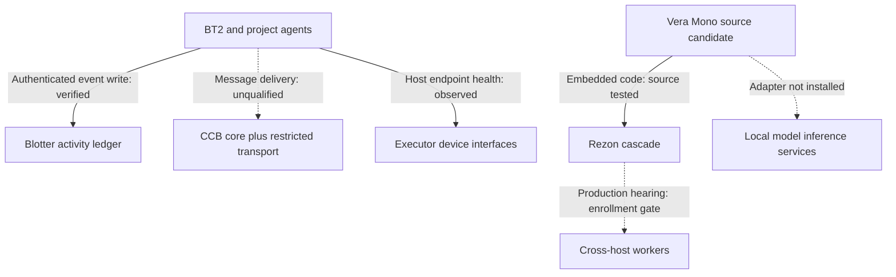

# BT2 ecosystem integration ledger — 2026-10-24

Status: **active, partial source repairs; no global operational qualification**.
Owner/coordinator: BT2 One. Canonical ledger branch proposed against
`thebrazenbeard/bt2@ba830cc2914813c3b4e76751f77b1cf3a132a5c4`.
This document is public-safe. Restricted repository identity and private
review details are intentionally excluded and must stay in permitted
private records.

## Evidence vocabulary

- **SOURCE** — exact Git branch/commit, not merged or installed.
- **BUILD/TEST** — exact-head automated/local tests, not real effects.
- **INSTALL** — a specific installed tree and version read back.
- **RUNTIME** — a service/process observed on a particular host.
- **E2E** — a real workflow with both endpoints and effects read back.
- **UNKNOWN** — insufficient permitted evidence. Internal/model review
  never upgrades one of the above classes.

## Public owner inventory and dependency boundaries

Owner-scoped public discovery identified 78 public repositories. The [public repository role inventory](PUBLIC_REPOSITORY_ROLE_INVENTORY_20261024.md) names all 78 and classifies them from current README/metadata only; its repository-specific installation and runtime states are UNKNOWN. An
exact Git-blob scan found a concealed VS Code `folderOpen` task and
disguised Node executable in **45 of those 78** public repositories,
across two observed asset variants. The affected checkout is a
**conditional startup exposure**, not evidence that the command ever
executed on a workstation. Additional access-restricted inventory
exists; neither counts nor identities are published here.

| Component | Responsibility | Actual connection or boundary | State |
| --- | --- | --- | --- |
| `vera-mono` | Canonical assembled Vera code: 12 Python package roots, persistent governance/recovery | Models, devices, databases and transports remain separately admitted external services | SOURCE and BUILD verified; restricted install/runtime readback is mismatched and not qualified |
| `rezon` | Multi-model reasoning and worker hearings | External repo is a donor/worker infrastructure; absorbed `packages/rezon` is internal to Mono | Test harness exists; production credential enrollment incomplete |
| `ccb-core` | Public reusable Bus/Radar production source and protocol tests | Deployment and private writer-lane overlays are external to reusable source | README source authority verified; deployed provider/version and delivery receipts unqualified |
| Restricted Bus transport | Non-PR agent messaging and private lane state | Shared coordination route is distinct from PR activity, Blotter events, and model reasoning | Whole-path current delivery qualification not established here |
| `blotter` | Agent event and effect/claim journaling | Authenticated restricted operator event endpoint; events must not be mistaken for independently verified effects | Restricted authenticated event recording verified |
| `executor`, `portal`, local devices | Authenticated execution and host/service interfaces | Devices require per-host connection, explicit capability and authority; no assumed implicit tunnel | Restricted execution path observed; cross-machine aggregate E2E UNKNOWN |
| `hc-brain` and AGI research documents | Hyperconnectome cognitive-organ design and evaluation contracts | Conceptual design/qualification evidence, not proof of a running organ or AGI | DOCUMENTED, not INSTALLED |
| Product/research repos | Other independent research or business domains | Use Bus/Blotter when coordination is justified; do not invent runtime dependency on Vera | Deliberately isolated unless tested interface warrants integration |

### Integration edges — observed versus absent

Solid arrows mean only the named limited evidence was observed; dashed arrows are proposed/missing runtime contracts. No edge alone proves effect authorization or whole-system installation. Independent product/research repositories stay isolated until a justified, executed interface is demonstrated.

The 45/78 finding is an exact-blob **SOURCE** scan, not a host
probe. Its [immutable public source manifest](PUBLIC_VSCODE_TASK_EXPOSURE_MANIFEST_20261024.md)
binds all 78 public repositories to their individual `main` HEAD
commits and task-blob identities at this snapshot: 41 match one concealed
Node loader variant, 4 match a second, 26 have nonmatching task files,
and 7 lack that path. The suspicious asset was present at each affected
pinned source head. No asset was executed, and current main/host status
may differ from the pinned snapshot.

### Public main source-head bindings at this checkpoint

| Repository | Main commit |
| --- | --- |
| `bt2` | `ba830cc2914813c3b4e76751f77b1cf3a132a5c4` |
| `vera-mono` | `64c4a756a8c4d6fc791787de80303f7ee0f64869` |
| `rezon` | `d27da3cab31ae96aff3c65385fc31354dc8aeb8c` |
| `blotter` | `2493b354488cefe4a3f0d2b80372b93c6b1cfeb4` |
| `portal` | `6b601b8b291bd59cd79bcc1a96befab50ec2ebda` |
| `vera-mesh` | `3242f72a0c4b9cb53679563c78f66528841296f5` |
| `vera-control-plane` | `0654b4a646f2168b672f4f78cef71e33bc79d643` |

All implementation PRs cited below are **draft and unmerged**;
none is an installation receipt. Source/change ownership is BT2 One
or the named independent specialist; merge/legal attestations remain
with Patrick and any repository-specific protected workflow.

## Verified source repairs and exact subjects
| Subject | Defect and minimum repair | Source head / tests | Install/runtime/effect |
| --- | --- | --- | --- |
| `vera-mono` [PR #88](https://github.com/thebrazenbeard/vera-mono/pull/88) | Remove hidden editor-startup task and disguised asset; correct ineffective workspace consent claim; add source test | `ba8fab6a4f24e4f0992f98c32970ba18dd07cfcb`; GitHub monorepo CI `40103160683` PASS | Draft; not merged, installed, or host-verified |
| `vera-mono` [PR #96](https://github.com/thebrazenbeard/vera-mono/pull/96) | `pip --target` generated console entrypoint omitted target from Python import path; package a self-locating launcher inside the wheel | `590639f3c745a3bbba3ba6de2f18df594a048154`; local 641 tests + 35 subtests PASS, wheel staged and launcher executed; Windows/Ubuntu CI `40105742775` and dependency review `40105742815` PASS | Draft; portable candidate built/tested, not installed into the governed target runtime |
| `vera-mono` [PR #97](https://github.com/thebrazenbeard/vera-mono/pull/97) | Local Ollama to Rezon **unverified candidate observation** via bounded loopback transport; malformed HTTP fails closed; synthetic reviewer remains unqualified | `93d65ce87609e05e354acb0f0068db96a4977670`; local 658 tests + 35 subtests PASS; Windows/Ubuntu CI `40108548034` and dependency review `40108548021` PASS; internal independent source review PASS | Draft; no live adapter host installation or real integrated model/effect qualification. Protected staging request denied. |
| `vera-mono` [PR #98](https://github.com/thebrazenbeard/vera-mono/pull/98) | Embedded Rezon cascade incorrectly marked below-threshold answers resolved when layers/iteration budget exhausted; fail-closed gate and no-dispatch tests | `4ea394a1b24e2a7bcb382d89eb3b77b88ec74214`; original red reproductions, local 642 tests + 35 subtests PASS; GitHub monorepo and dependency review CI PASS; independent exact-head source review PASS | Draft; unmerged; no deployed effect; does not establish separately hosted Rezon defect |
| `vera-mono` [PR #99](https://github.com/thebrazenbeard/vera-mono/pull/99) | Consolidate PR #88/#96/#97/#98 plus bounded semantic preflight; reconcile PR #97's obsolete assertion about unresolved candidate persistence and correct combined module documentation | `835cabe3b93a74360c5d0d672e7d3463dd797c45` / exact Git tree `f77ee738ed7d07d49d6d38abc44a9e9653bb0d5b`; full integrated local 667 tests + 35 subtests PASS, one existing collection warning; independent source review PASS and 9 remote blobs match locally tested tree; Dependency Review PASS and Windows/Ubuntu monorepo CI `40132646910` PASS (including wheel build/installed-launcher checks) | Draft; unmerged/uninstalled; no actual adapter-on-host or independently observed model-to-action E2E |
| `rezon` [PR #119](https://github.com/thebrazenbeard/rezon/pull/119) | Linux Secret Service fallback test could use an unlocked real keyring; isolate service path with a mocked fail-closed regression | `33cba8c8b9112953f6279639755605d95499d2ae`; GitHub kernel/benchmark tests PASS | Draft; no credential enrollment or production hearing |
| `vera-control-plane` [PR #156](https://github.com/thebrazenbeard/vera-control-plane/pull/156) | Remove concealed `folderOpen` executable, misleading editor settings, add unconditional path/blob guard | `3021e3ddd8cdb8882517ba914a3403004caacb84`; source guard CI `40107264453` PASS, independent internal source review PASS | Draft; not installed; general VCP integrity CI `40107264376` FAILS 6 historical Git-object tests (260 passed, 9 subtests) |
| `tattler` [PR #17](https://github.com/thebrazenbeard/tattler/pull/17) | Remove concealed VS Code folder-open Node loader and disguised asset; add source guard; fix inherited CI failure by explicitly fetching the SAME immutable historical SPK verifier commit before checkout | `2d6a14a695a772fd9d4916f33c9675179af54aff`; local 20 Python tests PASS; independent source review PASS; exact-head GitHub build `40134250159` SUCCESS including Go, Python, SPK package/DSM verification, Windows; exact-head CodeQL `40134247326` PASS, earlier security-head Dependency Review PASS | Draft; unmerged; source/build only, no installed host effect; historical external commit remains a durability dependency |
| `discovery` [PR #54](https://github.com/thebrazenbeard/discovery/pull/54) | Remove concealed workspace folder-open Node loader and disguised asset while retaining legitimate font/debugger files; add unconditional absence regression | `6dd26c5adc935b56cf2dde51a40621ea8ff12361`; local 164 unittests plus two validators and compilation PASS; exact-head GitHub Discovery validation `40134379391` and composed lifecycle `40134379394` SUCCESS; independent exact-head source/CI review PASS | Draft; unmerged, not installed, no host compromise attestation |
| `mediaphile-server` [PR #11](https://github.com/thebrazenbeard/mediaphile-server/pull/11) | Remove concealed editor-startup task, disguised asset and misleading consent; add source guard workflow; leave all Go source/dependencies untouched | `1c093c7361ce1269f22dd2314cd9105aaeeea6d2`; local source guard 3/3 PASS; independent exact-tree review PASS; GitHub guard runs `40134742661`, `40134725120` SUCCESS; Go test/vet/build workflow `40134742715` SUCCESS | Draft; no NAS deployment, install, media mutation or host execution conclusion |
| `cricket` [PR #5](https://github.com/thebrazenbeard/cricket/pull/5) | Remove concealed editor-startup task and disguised asset, correct misleading workspace settings and add auto-discovered source guards | `629644a71a6b94814d756f9fee82aa23e324ade6` / tree `8e916dda72b4ba72addeac70ad03318812d846e1`; original tests RED, source guards 3/3 and full 81/81 local pytest PASS, wheel build PASS; exact-head GitHub test run `40134970475` SUCCESS | Draft; not merged or installed; no workstation execution inference |
| `mediaphile-client` [PR #9](https://github.com/thebrazenbeard/mediaphile-client/pull/9) | Remove two distinct source-triggered Node loaders: editor `folderOpen` disguised asset and obfuscated `api.js` called by dev/build scripts; source-only static decoding of `api.js` shows remote code retrieval and detached Node execution; retain safe app tooling and add pre-dependency guard | `f753d82b3faa0dd76231663caaaa9e63ab96ab70` / exact tree `bb496239c7711ce1268fa5be3b1cd6040fdeff6e`; local sanitized source guards 3/3, typecheck, Vitest 12/12 and Vite build PASS; exact-head GitHub CI `40135216165` SUCCESS incl pre-dependency guard, npm install, typecheck, simulated browser flows and sanitized build | Draft; three historical GitHub Build steps invoked original `node api.js` (runs `39805382366`, `39805424160`, `39805476162`); downloaded-stage effects and physical-host execution UNKNOWN; no NAS deploy/install; original loader never executed during this review |
| `vera` [PR #222](https://github.com/thebrazenbeard/vera/pull/222) | Remove concealed VS Code startup task and disguised executable, correct invalid workspace auto-task claims, add dedicated source-only regression workflow | `d88730ec186a407e43235740264bf05cf0e5ca19` / exact tree `4fb7545ac8c1f0115a97ac086c9a2ecf443f2bfa`; local RED→3/3 source guard PASS, bytecode compile PASS; GitHub source guard `40135811887`, dependency review `40135811765` and release package `40135811718` SUCCESS; Temporal pilot `40135811844` and enforcement kernel `40135811759` SUCCESS; independent exact-head source/CI review PASS | Draft; no merge, host installation or historical execution conclusion |
| `mediaphile-client` [PR #10](https://github.com/thebrazenbeard/mediaphile-client/pull/10) | Reconstruct original PR #7/#8 legitimate subtitle review/search UI on top of sanitized PR #9, excluding all old executable startup paths; pin client API snapshot to exact server Git blob | `0a4c724bbd49468c5cdcc83e6879141d25fe1a1e` / tree `e6389f234b136185f161903d491134b9dd36b26d`; independent exact local diff review PASS; guard 3/3, TypeScript, Vitest 19/19 and sanitized build local PASS; exact-head GitHub CI `40135854899` SUCCESS incl source guard/typecheck/build/Chromium simulated-API flows | Draft; stacked on security PR #9 branch, not main; no NAS effect, published provider setup or runtime qualification |
| `vera-R9A0` [PR #25](https://github.com/thebrazenbeard/vera-R9A0/pull/25) | Remove concealed editor startup task/disguised asset; preserve checksum-bound original workflow; add independent unconditional guard workflow | `8760c09f89cf03265344247056df5de44d5e25a5` / tree `6a020ea40530cc528cd8d610a457fda15532fe8b`; source guard 3/3 and native suites 70/70 + 32/32 local PASS, exact-head GitHub guard `40136226999` and native `40136226997` SUCCESS, independent review PASS; one unrelated broad local discovery failure reproduced on pristine main | Draft, unmerged/uninstalled, no host execution conclusion |
| `ccb-core` [PR #22](https://github.com/thebrazenbeard/ccb-core/pull/22) | Bound provider HTTP503 diagnosis to five allowlisted codes, suppress arbitrary body and chained tracebacks; adds regression; provider actual fault NOT fixed | `c8bd7e4f67add7407407a606172c50a1248c86bd` / tree `1d0e36958fa8459ae8114e4ddc9fbac4f3560d6b`; local focused12 and full255 PASS; exact-head GitHub CI `40136287454` and dependency review `40136287509` both SUCCESS | Draft/unmerged, 171 historical scheduled Radar failures and authenticated 503 persist; no live Bus message delivery receipts |
| `mediaphile-server` [PR #12](https://github.com/thebrazenbeard/mediaphile-server/pull/12) | Reapply only 34 legitimate subtitle review/queue/provider staging backend paths on sanitized Server PR #11; API snapshot matches clean client PR #10 exact Git blob; preserve explicit staging before separate manual install | `d9778664f8aa88309f4179025302aa4a6bedfb09` / tree `0a6afa8ce438dd1a4861861dd8ff68c36e5cba26`; source guard 3/3, diff check local PASS; independent static code/security review conditional PASS; Go 1.26 unavailable locally; exact-head GitHub Go CI `40136594166` (test/vet/build) and source guard `40136594727` both SUCCESS | Draft stacked on Server PR #11; no live NAS, API credentials, subtitle install or production effect; staged published subtitles need manual review/promotion |
| `unbound-sol` [PR #44](https://github.com/thebrazenbeard/unbound-sol/pull/44) | Remove concealed editor loader and disguised asset; wire existing public scanner and 11 regressions into continuity CI | `3e26275ac53f7f9109b740a16f884f8b80124849` / tree `5da3f938075709199219df24e17306148c09481d`; baseline scanner 6 findings, after NO_MATCH, 11/11 tests and public validator local PASS; exact-head GitHub continuity `40136752135` SUCCESS | Draft/unmerged; no runtime, editor host or independent host compromise conclusion |
| `blotter` [PR #5](https://github.com/thebrazenbeard/blotter/pull/5) | Clarify seven self-reported effect classifications; preserve compatibility defaults; add CLI/store explicit OBSERVED round-trip regression after cross-chat event exposed inconsistent actor metadata | `de80f57dfb3cd8e78cb264e73f5643aaabdba369` / tree `e12ca6d1552593ff1e99569503c2aacfd3d0bd4c`; local full 35/35 unittest PASS incl HTTP; GitHub CI pending | Draft; live Blotter event read/write already authenticated but PR not merged/installed; a recorded effect remains a claim until independent receipt |

**Historical CI source execution (Mediaphile Client):** Verified GitHub-hosted Actions Build logs for unsafe main runs [39805382366](https://github.com/thebrazenbeard/mediaphile-client/actions/runs/39805382366) (job `119917119873`) and [39805424160](https://github.com/thebrazenbeard/mediaphile-client/actions/runs/39805424160) (job `119917258162`), plus unsafe feature PR #7 run [39805476162](https://github.com/thebrazenbeard/mediaphile-client/actions/runs/39805476162) (job `119917430548`). Each successful Build step printed `> node api.js && tsc --noEmit && vite build`. This is **real execution of the original obfuscated first-stage command on ephemeral GitHub runners**, not proof that its network stage succeeded, it downloaded or launched additional code, accessed secrets, or affected personal computers or storage systems. PR #8's observed build script was sanitized and is not included in those three invocation claims.

**Integration lesson:** independently green PRs #97 and the semantic-admission patch initially failed when combined because an old test expected caller-provided semantics to persist after unresolved reasoning. The PR #99 aggregate was exercised as one exact tree; no source-only PASS should be promoted into runtime or AGI qualification. A rejected dispatch after resolved reasoning may still leave a schema-valid caller-supplied semantic row, which is not automatically truth.

**Mediaphile Client stale PR hold:** PR #7 still has the obfuscated build loader and editor auto-task on its open feature branch. PR #8 targets #7 (not main) and retains the suspicious asset blobs even though its package scripts stopped invoking api.js. Neither feature should be integrated as-is; replay the legitimate changes on the source-sanitized #9 tree and requalify the final exact branch before any merge.

**Known reintroduction hazards:** old draft PRs may re-add the
concealed `folderOpen` commands after a security fix. In particular,
VCP PR #155 contains a stale editor task diff. Tattler PR #13 likewise reintroduces the concealed startup task and asset and must be sanitized or held. Any merge train must
diff against a sanitized head and rerun source guards.

Security tests inspect paths and Git blobs; they never execute the
disguised assets. No source review proves whether a host was previously
affected. Windows VS Code automatic-task behavior depends on effective
user/application settings and consent; a workspace setting is not a
reliable mitigation.

## Source merge and installation dependency gates

| Scope | Safe candidate order | Required qualification before effect |
| --- | --- | --- |
| Mediaphile Client | Security PR #9 precedes rebuilt subtitle feature PR #10 (currently stacked on #9), never merge stale #7/#8 heads as-is | Rebase final combined head, source guard + browser CI, owner merge, installed client version and live API E2E |
| Mediaphile Server | Security PR #11 precedes rebuilt subtitle backend PR #12 (stacked on #11), never merge stale feature-chain heads as-is | Final Go tests/vet/build, isolated private staging root, owner merge, NAS deployment readback and explicit staged-to-reviewed-install workflow |
| Vera Mono | Consolidated PR #99 is integration candidate; independent #88/#96/#97/#98 are overlapping donors, not four separate production installs | Reviewed exact aggregate, owner merge, wheel install/version, bound model adapter, model-to-effect adversarial E2E |
| Rezon external workers | PR #119's test-isolation/credential backend fix stays in external worker project, not absorbed Mono reasoning kernel | Owner merge/installation and confidential local enrollment before four-real-worker persisted production hearing |
| Public editor-source containment | Security guards precede older feature PRs that may reintroduce known startup blobs | Inspect every final Git tree, source CI, and relevant application build; no host-clean claim from Git changes |
| Public Bus diagnostic source | ccb-core PR #22 is diagnostics, not a provider repair; active projector source remains separately pinned and qualified | Owner-authorized source activation and provider cause correction, successful authenticated cursor/journal receipt and canary message |

No single PR is a deployment receipt. Protected trust anchors and private runtime paths are deliberately excluded from this public report.

## Restricted runtime evidence (not public telemetry)

Authorized private operator readback confirmed bounded **real** local-model
inference and authenticated durable agent-event read/write. A model-generated
answer also contained a concrete factual misreading, so model output remains
an unverified candidate. The Vera runtime's installed provider binding and
cross-machine production hearing remain unqualified.

Exact machine names, endpoint addresses, installed model identifiers,
host/application versions, local service states, execution timings,
event-sequence numbers and sensitive runtime configuration are retained
only in restricted operator/Blotter records. This public ledger does not
republish them or imply that observed source/CI fixes reached production.

## Important blocked or unverified work

1. **Owner merge gates.** Repository CLAs and explicit no-merge rules
   must be satisfied by the owner. Do not make legal attestations on
   the owner's behalf, merge drafts under HOLD, or erase Git history.
2. **Production Rezon workers.** Secure credentials must be enrolled
   through owner-authorized private-local mechanisms; no credential
   printing, transport substitution, or synthetic production hearing.
3. **Mono deployment.** First sanitize and review source; then rebuild
   exact wheel, install with rollback point, bind real providers, and
   verify status/effects after service start. Green CI alone is
   insufficient.
4. **True model reasoning chain.** A bounded local model call is proven,
   but Mono/Rezon/provider/result persistence and independent epistemic
   review are not yet verified as one executed workflow.
5. **Cross-host delivery.** Authorized machines and the Bus require a fresh
   simultaneous endpoint-and-receipt test, including retry/recovery.
6. **Wider security inventory.** Remaining affected public repositories
   and stale draft PRs require individual authority checks and
   reconstructible regression fixes; do not bulk merge without review.
7. **AGI qualification.** Hyperconnectome architecture is conceptual;
   hardcoded closed-loop probes are not held-out real-model
   generalization. Separate evidence, runtime, and reviewer roles.

## Resume from this ledger

Fresh-check canonical main plus every draft head and new CI run. Recover
restricted PR details only through authorized private evidence.
Review exact-source defects, reconcile stale PRs, respect owner gates,
then install and exercise one real cross-boundary workflow at a time.
Carry the exact source, build, installation, runtime, effect, rollback
and receipt IDs into subsequent ledger revisions. No scheduled or
background continuation is asserted by this document.

## 2026-10-25 execution continuation

These are exact-source checkpoints from the subsequent execution session, not a claim of a fully installed ecosystem.

- **Mediaphile Server** [draft PR #13](https://github.com/thebrazenbeard/mediaphile-server/pull/13): head `001245f90ae856e373c41ec1a1055d3ac0877633`, tree `b49e1421d4118898c9335fafa26606f67674c958`. Staged-provider preview and explicit no-overwrite publication, admin fail-closed, playback file mode and staging-directory overlap regressions; Go test/vet/build run `40147573896` SUCCESS and startup safety `40147573892` SUCCESS. SOURCE+BUILD/TEST only; NAS mount is documented read-only, writable authorization/hardlink/actual Plex readback remain HOLD. The check does not validate the stage root against every separate library.
- **Mediaphile Client** [draft PR #11](https://github.com/thebrazenbeard/mediaphile-client/pull/11): head `32e9ebbb86189054e5e3a25f1c95786aae36639e`, tree `41a103a39f321cbad5545375bce3031ce0f1b5ec`, API contract pinned to Server head above. Exact-head CI run `40148384543` SUCCESS: startup guard 3/3, Vitest 26/26, TypeScript, build, Chromium Playwright 10/10. Tenth browser case tests mismatch rejection, escaped preview, explicit confirmation and install request with a SIMULATED API; real Server/NAS/Plex E2E not tested. Both client/server PRs remain draft and stacked on prior sanitized source/security PRs.
- **Rezon** [draft PR #119](https://github.com/thebrazenbeard/rezon/pull/119): head `33cba8c8b9112953f6279639755605d95499d2ae` remains open/unmerged. The original Python Secret Service test-isolation correction passes source/CI, but independent cross-collection duplicate simulations reproduce false enrollment success. An isolated unpublished repair and regression are reported locally, not installed or published; PR119 overall HOLD. [Issue #120](https://github.com/thebrazenbeard/rezon/issues/120) records a gateway that reports ready when storage fails; bounded `/readyz` compatibility patch is local-only and its scope is lock/schema-shape, NOT proof every episode write succeeds.
- **Chat Communication Bus**: canonical [ccb-core draft PR #22](https://github.com/thebrazenbeard/ccb-core/pull/22) is an exact-head CI-passing diagnostic source change only. Authenticated provider HTTP503 persists, no independently verified end-to-end delivery receipt; protected provider configuration remains owner-gated. The exact cause is UNKNOWN, despite a source-based hypothesis.
- **Vera Mono self-learning**: [Goal 1 draft PR #89](https://github.com/thebrazenbeard/vera-mono/pull/89) head `4d3cdb5dee90161771c29d388ba903fd97571eac`, CI `40134833760` SUCCESS, contains executable research-only signed-claim/mTLS and disposable networkless worker mechanisms, with an inert backend; no independently administered evaluator, selected real model, protected holdout, or demonstrated behavioral learning. A separate isolated local source experiment adds bounded strategy selection/consumption and tests; independent reviewers demonstrated that a prior reviewed method receipt could issue even when actual callback ignored it, and they are testing exact selection/evidence binding. Local research changes are NOT installed or canonical qualification.
- **Coordination and Blotter**: BT2 acknowledged cross-session ownership in [Bus issue #387](https://github.com/thebrazenbeard/chat-communication-bus/issues/387). The local Executor tunnel did not return an authenticated Blotter last-20 refresh or append in this continuation; fresh Blotter currentness is UNKNOWN and no new event is claimed. Earlier verified events cannot be promoted into current readback.

Cross-repository installation and runtime effects are still HOLD. Respect per-repository main merge gates and never treat CI or a model/reviewer statement as a NAS write, four-real-worker hearing, delivered Bus message, or causal AGI learning proof.

## Oct 25 verified continuation — self-learning and source containment

- **Vera Mono authored-method research**: Draft [PR #100](https://github.com/thebrazenbeard/vera-mono/pull/100) exact head `26b28eb366dc86ec3219319014765d99cefa4899`, 3-file stack on PR #99; Ubuntu exact-head CI SUCCESS but Windows exact-head [run 40149128451](https://github.com/thebrazenbeard/vera-mono/actions/runs/40149128451) FAILURE: 672 passed, 7 failed, 1 skipped, 39 subtests. All seven new tests fail temporary-dir cleanup with WinError32 because SQLite connection context managers commit but do not close in `DurableLearnedInfluenceGate.__init__` and `review`. Source repair is in progress; PR100 NOT cross-platform qualified or installed. Separate synthetic shift diagnostic found A calibration 1/2→2/2 but 10-case later distribution shift baseline4/10 vs selected2/10; B/C evidence can be supplied by the same operator and independence is NOT established. Learning/promotional effect stays NONE/HOLD.
- **Vera Mono Goal1 [PR #89](https://github.com/thebrazenbeard/vera-mono/pull/89)** exact remote head `4d3cdb5dee90161771c29d388ba903fd97571eac` still source-only. Hostile review reproduced unbound registry-digest dispatch and unbounded broker stdout/queue risk using inert substitutes. Initial equality patch was RETIRED because registry-reported digest and reserved artifact SHA are separate evidence domains. Corrected LOCAL unpushed candidate `49daa7bb11894d7346adafe8d3fbaf16a299e104` / tree `56192724ae3962df7e47ee9262d16ed76068185a` pins both separately; 760 tests/64 subtests pass and 5 optional skips; independent review pending. Separate LOCAL bounded broker candidate `9b31e40646af157e98e37a59a6bce4a31bd7e8f9` passed 43 tests but hostile inert interleaving reproduced callback invocation before late extra-frame rejection; pre-effect strictness remains HOLD. Neither patch published/installed.
- **[Mosaic security PR #13](https://github.com/thebrazenbeard/mosaic/pull/13)** exact head `9ee0e0968e3a64cdd65bb9a6cf610abedb24b32a`, both exact-head GitHub workflows completed SUCCESS. Source-only editor startup loader containment, not workstation effect proof. Stacked older Mosaic PRs require rebase/guards to avoid reintroduction.
- **[DriftGuard security PR #45](https://github.com/thebrazenbeard/driftguard/pull/45)** draft head `d59b0695a26ebeddbea2f3d8de3820b05d11f04b` tree `12fc29b95dd644be96efea8486f6e00292ad6a2f`, main base `4b94e1f86827609a46c1c41178964c6996de7fcb`; five-path removal of concealed editor startup loader and CI source guard. Local 306/306 PASS and independent Systems Architect Two 306/306 PASS, action-smoke CI SUCCESS while tests/CodeQL pending at this snapshot; no deployment.
- **[Ingest security PR #27](https://github.com/thebrazenbeard/ingest/pull/27)** draft head `fe3b71ce10b0acb37ad844c665380d8ccae174e7` tree `d4400f682d4e56c8d8d7951548f20ab0cf71600d`, base `8c77610781a4d9c598651a681253f26d3832c437`; five-path removal and CI source guard. Local 110/110 PASS with allowed ephemeral loopback; independent guard 3/3 PASS and suite 109 passed/one sandbox socket PermissionError. Exact-head remote CI not yet read. No workstation execution/installation.
- **Rezon receipt research gate** LOCAL only commit `1f160e6a82d03609cea50211905af40aa58f0d3d`, tree `6f025fefedf9125e72a02fbf65c47979a386504e`; 444 pytest+22 subtests local and independent 20-focused adversarial PASS; outsider-answer substitution now REJECTED. All actual model/independence/self-learning/production flags remain false. Another terminal reports new Rezon draft PR #121 stacked on #119; cross-source exact-head compare pending, no duplicate promotion by BT2.

No demonstrated autonomously generated method, independently sealed holdout, actual altered model weights, qualified production Rezon hearing, installed Vera Mono learner, or production self-learning effect in this continuation. Owner/protected merge and credential authority boundaries remain unchanged. Blotter fresh last-20 and append remain UNKNOWN because the authenticated Executor tunnel has not returned a result; this ledger is a different durable checkpoint, not a substituted Blotter entry.

### Later Oct 25 exact-head source/CI confirmations

- Published stacked **Vera Mono [PR #101](https://github.com/thebrazenbeard/vera-mono/pull/101)** for separately pinned Goal1 registry/artifact identities. Remote commit `1915bcce00c1f01fd225cb5ceb8ce01aae0d92d7` exactly reuses independently reviewed local tree `56192724ae3962df7e47ee9262d16ed76068185a`. Source ACCEPT (independent 24 focused+2 subtests), production HOLD: same-operator substituted expected pin still passes, so external authenticated pin custody and loaded weights are unproven. GitHub exact-head CI in_progress at checkpoint.
- Published stacked **Vera Mono [PR #102](https://github.com/thebrazenbeard/vera-mono/pull/102)** to address the FAILED Windows PR100 CI. Remote commit `fc1f455aea3888f31223aa2c82b12af1dcc503fd`, exact reviewed local tree `8f85b572822a6e5731561b93c35724eda0153e5d`, four changed paths covering six previously unclosed SQLite scopes in learned and corrective ledgers; source local + independent full **683 tests/39 subtests PASS** with permitted loopback; separate Windows exact-head CI in_progress. This is a source candidate, not proof WinError32 resolved on Windows until CI readback.
- **DriftGuard PR45** exact-head GitHub tests, CodeQL, action-smoke all **SUCCESS** (runs `40149517345`, `40149517171`, `40149517143`). **Ingest PR27** exact-head GitHub CI `40149638585` **SUCCESS**. Both still DRAFT, no merge/install; repository CLA and owner review gates still apply.
- Corrected fresh owner-scoped GitHub enumeration with `page_size=200` reports **102 repositories: 78 public, 24 private, 4 archived** on Oct25. The earlier 100/76 result was a silently truncated `page_size=100` response; `page_offset=100` misleadingly returned zero. Independent reconciliation found **all 78 historical public-inventory rows still public**, none missing or newly public; the public inventory is complete by name at this observation. This count supersedes the older 97-total and 100-total claims, but is metadata rather than installation evidence.

### Event `bt2_kicks_ass_chews_bubblegum` — One↔Two and learning loop repair continuation

- **Vera Mono [PR #101](https://github.com/thebrazenbeard/vera-mono/pull/101)** remote head `1915bcce00c1f01fd225cb5ceb8ce01aae0d92d7` **full GitHub Ubuntu+Windows CI SUCCESS**, source-only, independent digest/pin custody and physical runtime still HOLD.
- **Vera Mono [PR #102](https://github.com/thebrazenbeard/vera-mono/pull/102)** remote head `fc1f455aea3888f31223aa2c82b12af1dcc503fd` actual GitHub Windows run `40150048338` FAILURE: earlier 7 SQLite cleanup failures reduced to **one**, `test_generic_reason_callback_can_ignore_revision_but_bound_method_cannot` WinError32 on **`semantic.db`** (681 passed,1 failed,1 skipped,39 subtests). Ubuntu job SUCCESS. This replaces prior in_progress snapshot; PR102 remains RED.
- **Vera Mono [PR #104](https://github.com/thebrazenbeard/vera-mono/pull/104)** DRAFT stacked on PR102, source head `eaec9eb3504ec0fefd3b644a9f38fd6cbfebc44e`, tree `5df7287c60d36c1e2e9c607d1e60f76a7d26bc59`; 7 changed paths. Integrates (i) algorithmic literal corrective rule induction from labeled A errors, persisted selection and later use, (ii) Ed25519-signed exact C cue/use outcome with durable negative-transfer quarantine and stale/replay/mixed-evidence rejection, and (iii) red→green file-backed SemanticKnowledgeStore owned connection closure preserving borrowed in-memory semantics. Root local **703 pytest +43 subtests PASS** with approved disposable localhost, focused32+4 PASS, compileall/diffcheck PASS. Individual AGI learning components received independent source/hostile review; integrated exact-head CI and cross-boundary human review pending. This is `authorization_effect=NONE`, *not* a qualified production learner or model-weight modification. Same-operator synthetic losses are not causal evaluator evidence; shifted set baseline3/3 beats induced2/3, so there is demonstrated possible negative transfer.
- **Rezon PR121** source CI success; local follow-up **post-save wrong-secret byte corruption** falsifier/repair on top of PR121 `b96e13294937f5486f81fd1c519cf40e9280a7d3`, tree `386c3b0d992d16d3d87d2be9029f8e1266089620`, 433 tests+22 subtests PASS, held local pending owner/protected PR chain and exact remote review. No real keyring credentials handled.
- **CCB** ccb-core PR22 exact source 12/12 diagnostic PASS but provider 503 root cause still UNKNOWN; no private Edge config readback or Bus receipt. **Host:** authenticated Executor and WorkBridge Commander timed out; a separate Remote Desktop transport reports Lappy online only. Legacy Lappy operator skill explicitly disallows reuse; no machine command, model inference, installation or Blotter append performed by this execution. Bus issue387 serves coordination only, not a substituted delivery receipt.

### Event `bt2_live_coordination_intranel` — source/CI and protocol checkpoint

- **Vera Mono PR104** head `eaec9eb3504ec0fefd3b644a9f38fd6cbfebc44e` / run `40151172424` **COMPLETED/SUCCESS** for both Ubuntu and Windows. Source and cross-platform test qualification only, no installer/runtime/independent evaluator/AGI claim.
- **Intranel main** current semantic INTRANEL/1 type contract separates origin/actor/target, immutable exact subject, logical operation/idempotency, receiver-owned effect admission, and receipt claim. Existing `adapters/BUS_PROFILE_V1.md` defines carrying canonical Intranel payload over the existing CCB transport, not replacing CCB, Blotter, identity or authority. No verified installed Bus adapter/delivery.
- **Intranel source safety**: main and stacked PR #12 contain concealed VS Code folderOpen Node executable `.lkf` plus permissive automatic-task settings. Source reviewers are preparing containment; do not open unsafe branches in auto-executing editor. Historical execution/effect unverified; stacked PRs must be checked to prevent reintroduction before any merge.
- Event ID `bt2_live_coordination_intranel` is coordination correlation, not cryptographic actor identity or effect authority. The previous `bt2_kicks_ass_chews_bubblegum` checkpoint remains separate. BT2 One posted an issue #387 coordination update; GitHub comments do NOT equal delivered authenticated CCB messages.

### Intranel coordination checkpoint — 2026-10-25 UTC (correlation `bt2_live_coordination_intranel`)

- **Intranel source-security containment published:** branch [`fix/contain-editor-autorun-20261025`](https://github.com/thebrazenbeard/intranel/tree/fix/contain-editor-autorun-20261025), commit `9746fe5d036b547f2c2387b745eaaee70d052f6f`, exact Git tree `fb8b4bbfbb1255c140d0871f903b6bc36ad0ab1f` matches local tested containment tree. It removes `.vscode/tasks.json` automatic Node launch, disabling settings and disguised `public/fonts/fa-solid.lkf`; adds pre-dependency CI guard and seven adversarial source tests. The local 90-test repository suite PASS, independently rerun security guard 7/7 PASS; GitHub branch remote `tasks.json` and `.lkf` 404, new guard present. **Branch only**, no PR/merge/host execution/installation. Repository CONTRIBUTING requires owner CLA legal assent for a PR, not provided here. Existing stacked Intranel PRs #9–#12 still contain the hazard and must be sanitized before promotion.
- **Intranel/CCB boundary:** Intranel main `25a2332...` supplies typed semantic `INTRANEL/1`, and `adapters/BUS_PROFILE_V1.md` defines a Bus wrapper, not deployed transport. CCB `9d53ce2...` supplies actual writer-lane grammar/routing. Independent source tests exposed incorrect node ID in `RadarEnvelope.audience`, untrusted writer-local ID confusion, priority-0 immediate dispatch, multi-node identity fanout, outbound size asymmetry, and incomplete semantic validation. Local-only guarded prototypes have progressively demonstrated actual `Router.route` and safe read-only QUEUED behavior; no authenticated writer/recipient mapping, source-admitted cross-machine delivery, replay persistence or runtime effect receipt. Intranel `RECEIPT` is still a semantic claim.
- **Real Bus provider fault:** exact GitHub-hosted scheduled runs [40135678333](https://github.com/thebrazenbeard/chat-communication-bus/actions/runs/40135678333) and [40144200780](https://github.com/thebrazenbeard/chat-communication-bus/actions/runs/40144200780) both fail `Project canonical reconciliation targets` through trusted private `body_bound_oidc` with HTTP 503. They do **not** execute the reviewed `ccb-core` PR22 diagnostic source. Allowlisted provider code/root cause and a real delivery receipt remain UNKNOWN pending owner-authorized trusted-control rollout and authenticated canary.
- **Vera Mono self-learning falsifiers:** Draft PR104 at `eaec9eb3504ec0fefd3b644a9f38fd6cbfebc44e` still has exact-head Windows+Ubuntu CI PASS `40151172424`. Independent RED evidence showed prior A/B evidence identity could be laundered as later C `cue_event_id`; isolated correction local commit `26736db714f967c3a178d44b462a46b920374cd3`/tree `3bf1cf84016540457319e84932061477670209fe` full 704 pytest+45 subtests PASS and Two independently reviewed, **not yet published**. An additional C cue/outcome identity collision and missing durable proof of actual research method execution remain under review. No installed learner, independent outcome/evaluator attestation, model-weight update or AGI qualification.
- **Coordination evidence:** BT2 One authored [Bus issue #387 checkpoint comment 6392128200](https://github.com/thebrazenbeard/chat-communication-bus/issues/387#issuecomment-6392128200), a GitHub record, **not** authenticated Bus delivery. A shared event tag belongs in Blotter `correlation_id` with unique event IDs. This terminal could not authenticate Blotter latest20/append because configured Executor/WorkBridge failed; no journal persistence is claimed.

### Event `bt2_live_coordination_intranel` — verified publication and learning controls, 2026-10-25 UTC

This checkpoint supersedes *status* statements in older sections but preserves their historical observation and exact subject. Patrick subsequently explicitly authorized reviewed, passing, non-destructive merges and requested main/README maintenance; repository-local CLA, protected branches, clean merge-tree proof and unfinished/staked PR qualification still govern promotion.

- **Intranel source containment:** clean-parent branch `fix/contain-editor-autorun-20261025` at exact Git commit `9746fe5d036b547f2c2387b745eaaee70d052f6f`, tree `fb8b4bbfbb1255c140d0871f903b6bc36ad0ab1f`, published/read back. Removes the known `.vscode` folder-open executable path and disguised `.lkf`; adds 7 regression tests, local complete 90-test suite PASS. Source branch only. Main and stacked PRs remain **UNSAFE** for auto-running editors until sanitized and independently merge-tree verified.
- **Intranel Bus protocol documentation:** branch `docs/bus-profile-wire-compatibility-clean-20261025`, commit `2b45276d9a908521e0d249a716b7d935f0f2cf2e`, tree `5550ed9076b5279cf26894644f7b493e0676dfca`. Clean parent above, optional namespace header mapping, separate semantic/writer-local identifiers and predecessor/parent linkage. Source-stage two-packet progression and stale-predecessor rejection PASS; no Bus delivery claim.
- **CCB reusable source adapter:** `ccb-core` branch `integration/intranel-read-only-adapter-20261025`, commit `2abd897a120a6c9e5ed27a27f04acb3e2a28789e`, tree `4bc2de1bdf061b146d75c70498fd6d25d73274e9`, remotely read back. Actual in-memory `SafeLaneAppender` sequential delivery/readback, duplicate/collision/stale-head checks PASS; full CCB 259 pytest, 16 focused, 12 hostile, 6 cross-repository FakeGit test PASS. OPEN/READ_ONLY only. No live authenticated CCB writer/recipient, provider append, ACK/effect or private projection receipt, and unchanged hosted 503 evidence above. Branch-only push did not trigger PR-filtered CI.
- **Rezon credential store integrity:** successor branch `fix/rezon-pr121-postsave-secret-check-20261025`, commit `b194670652b5724447e5cb25c8720b7c56852450`, tree `386c3b0d992d16d3d87d2be9029f8e1266089620`; verifies saved Python Secret Service item **bytes**, not merely item path, using constant-time comparison. Mock-keyring original RED → fixed GREEN, local 433 pytest +22 subtests PASS and exact remote source readback. Parent PR121 remains Draft/unmerged, production enrollment and four-host hearing unqualified; branch-only push does not trigger PR CI.
- **Vera Mono learned method integrity:** Draft [PR104](https://github.com/thebrazenbeard/vera-mono/pull/104) advanced to head `af0d1d42f36b6adddec9e8cf9ff4410ae99791e3`, tree `aff15b55b7a18c88cd9dbad312f41cf0625b72ff`, 8 exact changed file blobs verified by independent Two. Cross-role same-revision A/B/C evidence identities now disjoint even with orphan history rows. Local 713 pytest +60 subtests PASS, separate 10 hostile methods PASS. [GitHub run40153521615](https://github.com/thebrazenbeard/vera-mono/actions/runs/40153521615): Ubuntu pytest/wheel/installed-wheel **SUCCESS**, Windows test job **IN_PROGRESS** at latest readback. PR body refreshed with current evidence. Draft PR104 remains stacked on unfinished #102 → #100 → #99 and not main/installed.
- **Learning causal gap under repair:** independent deterministic RED shows C consumption fence durably commits before the execution outcome is recorded; a crash can leave actual method execution UNKNOWN and block replay. A disjoint worktree candidate stores a bound preparatory attempt record with `execution_state=UNKNOWN` atomically with C consumption; initial 21 focused tests +4 subtests PASS, full/independent review still pending. This is recovery provenance, not proof a method executed, learned causally, updated model weights, or achieved AGI.
- **Host/security scope:** Noema main `6886594db65a26f873ba58436f34c3f1d4db7d01` shares identical concealed editor startup hook/blob signature with `intranel`, `vera`, `selfimage`, `tattler`; source hazard, no host-compromise conclusion. Noema containment is in isolated worktree under independent adversarial testing; no E0 experiment runtime/authority granted. The existing Noema E0 token constructor only checks nonempty strings and is not cryptographic authority admission: host must not interpret it as production grant.
- **Coordination and activity ledger:** [Bus issue #387](https://github.com/thebrazenbeard/chat-communication-bus/issues/387) hosted comments are coordination evidence, **not** private Bus writer receipts. This terminal cannot authenticate the Blotter latest20 or append endpoint because local control transports timed out; no direct Blotter event is claimed. The shared text `bt2_live_coordination_intranel` is correlation only, never an identity or credential.

**Open promotion gate:** Revalidate every repository's README, PR contribution/CLA/branch rules, whole merge tree (especially concealed startup hooks), full exact-head tests, independent review, and actual CI. Do not treat a repo's source-only branch as a repaired main, an installed host service, or an operational cross-machine workflow.

#### Later exact-head gate/readback (same correlation, 2026-10-25 UTC)

- **Vera Mono PR104 GitHub CI updated:** [run 40153521615](https://github.com/thebrazenbeard/vera-mono/actions/runs/40153521615) now **COMPLETED/SUCCESS** on **both Ubuntu and Windows** against verified exact source head `af0d1d42f36b6adddec9e8cf9ff4410ae99791e3`. Windows monorepo tests, wheel build/closure and installed-wheel checks passed. PR description corrected. Current CI success does **not** qualify direct merge to main: #104→#102→#100→#99 are stacked Draft PRs, parent #100/#102 had failing CI at their old heads, repository CLA requires owner express declaration absent from PR bodies, and branch protection details were inaccessible (403). Aggregate integration against main needs whole-tree review and new CI; no merge/install.
- **README source corrections published:** Intranel clean security-parent Bus profile branch `docs/bus-profile-wire-compatibility-clean-20261025` advanced to commit `bf0fa0bd8778ef93f438a255aed2f2ce8074fad5`, README blob `e8e2ea8ead7bad119731ab7af9913471f2c95cf9` readback; distinguishes optional CCB cross-chat carriage from installed peer delivery and execution. CCB-core adapter branch `integration/intranel-read-only-adapter-20261025` advanced to commit `42b6f69ce8829a507a9c2dda90c28b7f80bbf560`, README blob `2406a9b9d19fa4dd2d27a0c99b631d3e3fdffefa` readback; explicitly limits FakeGit read-only results and leaves live host peer delivery separate. Both branches SOURCE only, main unchanged.
- **Noema security containment test gate:** local immutable commit `0a89f4d097bed62374cd2791a7f92892fe4e661d`, tree `699556117c7a236ede9cd9a4991960d7569194c4`, removes the exact known concealed editor loader, disables auto startup, adds CI-before-dependency guard and README; exact CPython3.13.5 full 110 tests PASS, separate 5 hostile probes PASS (Unicode escaped JSONC, symlink source, case-insensitive config). No remote publication readback at this checkpoint; no E0 execution/authority.
- **Durable method-attempt candidate:** independent deterministic RED after C fence before actual method execution, now atomic preparatory `UNKNOWN` attempt row candidate full 715 pytest+60 subtests PASS in isolated worktree; hostile review still pending. Signed C loss comparison remains an evaluator-provided claim, not independently proven execution.
- **Cross-agent coordination:** Bus [issue 387 comment 6392389553](https://github.com/thebrazenbeard/chat-communication-bus/issues/387#issuecomment-6392389553) communicates Patrick's clarified split: Intranel future actual Lappy/VN1/VN2 peer transport, CCB cross-chat; GitHub comment is not delivered authenticated Bus message.

#### Fresh actual host and shared Blotter runtime readbacks (2026-10-25 UTC)

- **Executor connector ACTUAL runtime:** live `list_devices` returned connected `Lappy`, `VERA-NODE-1`, `VN2`. Read-only `hostname` executed on all three: `Lappy`, `VERA-NODE-1`, `patrick-ThinkCentre-M900` respectively. This supersedes this terminal's *earlier* Executor timeout/inaccessibility checkpoint. Per-host service and credential qualifications remain separate.
- **Ollama physical runtime:** Lappy `ollama list` returned 4 installed tags `ministral-3:14b`, `vera-local:latest`, `qwen3:4b-instruct`, `qwen3:8b`; VN1 returned 3 installed tags `gemma3:1b`, `lfm2.5-thinking:1.2b`, `qwen3:1.7b`. Both initially `ollama ps` empty (no resident loaded model). VN1 `GET http://127.0.0.1:11434/api/version` returned version `0.40.9` and direct non-streaming `/api/generate` `gemma3:1b` completed `done=True` with generated response `READY...` (duration ~1.65s). Lappy `/api/generate` `qwen3:4b-instruct` completed `done=True` with a generated response (duration ~7.36s; prompt-token conformity not asserted). These are real **single-host local inference** effects only, not authenticated Rezon worker hearing or deployed Vera weights.
- **VN2:** authenticated Executor shell command returned `ollama: command not found` on current Linux PATH; read-only process enumeration confirmed `llama-server` and `sshd` running, `tailscale` and `ssh` executable present. Actual VN2 model generation/endpoint identity still pending an independent specialist probe at this checkpoint.
- **Tailscale** Lappy and VN1 read-only CLI JSON returned `BackendState=Running`, self hosts `Lappy` and `vn1`, three peers observed each. This proves local tailnet client state, not authenticated application message delivery or owner-authorized SSH effects.
- **Blotter central journal AUTHENTICATED:** Lappy existing credential-bound `bt2.one.lappy` actor, token consumed locally through normal configured private token file, never printed/exported; protected local Blotter service answered. Turn cursor `begin` completed pages1, 81 unseen records, and reviewed the latest 20 global activity messages, global cursor `1358`. A single real `integration_checkpoint` was posted with unique id `bt2_one_intranel_20261025_machine_probe_v1` and top-level `correlation_id=bt2_live_coordination_intranel`, `effect=NONE`; authenticated independent GET `/v1/events?after_seq=1358&limit=5` read back exact `seq=1359`, actor and correlation. This **is** durable Blotter EVENT evidence, not proof the journal's self-reported claims happened and not a Bus delivery receipt.
- **Known missing:** no installed Vera Mono service/process readback (a Lappy source/pilot location exists, but no Vera process was observed); Rezon production enrollment, multi-role persisted hearing, CCB 503 provider recovery, actual full cross-host peer protocol, independent causal learner verification/AGI remain unqualified. Do not infer remote credentials from connectivity or reuse tokens outside their actor.

#### Published security / recovery source and concurrent main merge (2026-10-25 UTC)

- **Noema complete source-security containment published:** branch [`security/noema-editor-startup-containment-20261025`](https://github.com/thebrazenbeard/noema/tree/security/noema-editor-startup-containment-20261025), GitHub commit `ee7eefe2d6b44eac058834f09ff37468fcbc7bbe`, exact remote tree `699556117c7a236ede9cd9a4991960d7569194c4` equals local independently tested immutable tree. Six text Git blobs independently matched local SHA, hidden `.vscode/tasks.json` and disguised `.lkf` 404 at branch head. Python3.13.5 local 110 pytest PASS, external 5 hostile static tests PASS including Unicode JSONC and font-root symlink evasion. CI predependency guard and README updated. SOURCE only; Noema implementation authority explicitly says `merge=NOT_AUTHORIZED` and E0 execute NOT_AUTHORIZED; main unchanged, no host cleanup/AGI claim.
- **Vera Mono crash-recovery successor source published:** branch [`research/method-execution-unknown-reconcile-20261025`](https://github.com/thebrazenbeard/vera-mono/tree/research/method-execution-unknown-reconcile-20261025), GitHub commit `b13a23f71add89eb49c7836a1f3c60c64df702f1`, tree `85d21ed9f17b9994cce257ac29750202f59d9b40` equals independently reviewed local tree; four blobs matched exactly. Full 715 pytest+60 subtests PASS; 6 independent hostile tests PASS incl old-row cold restart, replay, corrupt use-side row, forged split qualification. The journal stores bounded *claimed* preparation with `execution_state=UNKNOWN`, `authorization_effect=NONE` atomically with C fence; no causal execution attestation, method success, AGI or neural training. Original PR104 head `af0d1d42...` remains unchanged/open Draft and has Ubuntu+Windows CI SUCCESS; successor branch has no PR CI.
- **First integrated main source repair observed from concurrent team:** [Semiotics PR #5](https://github.com/thebrazenbeard/semiotics/pull/5) became MERGED during BT2 One's review; fresh remote `semiotics/main@1033db1c6bb68f058bb12a5960f033752254a9a8`, PR merge commit same SHA, prior PR source head `3239a5454b78a4b1781448a0d8eda8a5c6603b4b` and exact-head GitHub runs `40154643522` / `40154641816` both COMPLETE/SUCCESS. Main recursive tree has `.vscode` settings/tasks but NO `public/fonts/fa-solid.lkf`; README at main blob `848950a4262ef8c57aa4e0d39998ed306cb40c90` documents editor-startup hygiene. Independent previous clean tree 56 Python unittest PASS. This is a **merged source** result, not installed editor/host remediation. The concurrent execution thread performed the merge; this terminal only observed and verified it.

#### Hostile qualification REOPENED: orphan method-attempt evidence (2026-10-25 UTC)

Independent Systems Architect Two reproduced **SIX RED subtests** on exact Vera Mono journal branch tree `85d21ed9f17b9994cce257ac29750202f59d9b40` (remote commit `b13a23f71add89eb49c7836a1f3c60c64df702f1`, local-equivalent source commit `63380c83...`). Harness `vera-mono-hostile-tests/test_method_attempt_orphan_roles.py`: after legitimate atomic C cue/use UNKNOWN journal, simulated primary C row loss (consumption/use/pair) leaves journal surviving. `_evidence_roles` ignored `learned_research_method_attempts` identities: 4 old CUE/USE IDs accepted as new A/B and 2 accepted for new C. Existing journal-reader corrupt-state check is insufficient because alternate admission paths do not consult the journal. **Prior 715+60 full-green/hostile6 did NOT cover this; the b13 branch is SOURCE-PUBLISHED BUT REJECTED/HOLD for role-integrity qualification.** Fix assigned to independent implementer; require exact RED→GREEN, full suite, Two verification before successor promotion. No runtime effect, model-weight update, or installed learner conclusion.

#### Essential AI stack continuation and independent qualification (2026-10-25 UTC; event `bt2_fixes&integrates_all_veras_bullshit`)

- **Scope decision:** prioritize Vera Mono/OS, Rezon, authenticated Intranel, provenance-preserving memory/continual-learning research, and project-runner/Blotter/CCB as interfaces; unrelated industrial, literary, entertainment, and commercial repos are deliberately not made runtime dependencies. This is a bounded execution priority, not proof all AI repos were audited or installed.
- **Corrected Vera Mono orphan-journal role fence now independently PASS:** [source branch](https://github.com/thebrazenbeard/vera-mono/tree/research/method-attempt-orphan-role-fence-20261025) remote commit `e3f23b58c6fbc947d76ceba757458e8f3b2d0c46`, exact GitHub tree `edde66606052bd42b238cf6c8a846f401e768cdc` (independently reviewed local equivalent `4477f54c37f25724740b85e49c0a4b71460cd27b`). Original SIX RED hostile orphan C-journal role-admission tests now all GREEN; complete developer suite 717 pytest +66 subtests, independent external hostile 6 and rollback/restart/concurrency cases PASS. Systems Architect Two independently inspected exact tree and approved bounded SOURCE publication/PR update, **not merge, runtime, or AGI claims**. Atomic journal records claimed method preparation as `UNKNOWN/NONE`; neither proves causal action nor model-weight learning. The superseded first branch b13/tree85d remains historically RED.
- **Intranel fail-closed host-peer substrate SOURCE qualification:** [source branch](https://github.com/thebrazenbeard/intranel/tree/feature/intranel-host-peer-v1-20261025), remote commit `cf69476749c38400b69024a169fe3f390988a060`, GitHub tree `8afaf18e2fad3d1c40be4df7a600ccf8f086a585`, clean security-containment ancestor `9746fe5d036b547f2c2387b745eaaee70d052f6f`. Full 105 test suite + 9 independent hostile PASS; explicit bounded frames, SQLite persist-before-ACK, duplicate idempotency, lost ACK retry, ID-collision HOLD. Trust boundary **not yet closed**: `ObservedPeer` is caller-constructible until an authenticated real SSH carrier binds server-observed client key/account and pinned host key; source teammate is engineering it separately. No physical peer E2E claimed.
- **Three actual, *separate* local inference routes:** Lappy Ollama Qwen3:4B Instruct `/api/generate` non-streaming completed; VN1 Ollama Gemma3:1B `/api/generate` completed; VN2 loopback llama-server `127.0.0.1:11435` health returned OK, model endpoint identified `IBM Granite 3.3 2B Instruct Q4_K_M`, `/completion` generated bounded 8 tokens. VN2 `ollama` was absent on PATH. These satisfy individual model-execution/runtime evidence, **not** authenticated cross-host Rezon contributions or Vera installation.
- **Rezon main README/owner-local enrollment contract confirmed by specialist:** gateway route and expected worker roles are documented, but first remote health probe hung. The source enrollment instructions explicitly forbid credential enrollment via ChatGPT-connected remote terminals; no credentials transferred/enrolled here. Live persisted all-worker production hearing remains **UNKNOWN** until owner-local enrollment and independent runtime receipts. Rezon code/docs candidate branch `docs/rezon-keyring-postsave-clarity-20261025` remote `0563a42bd366bb9fd9bf84efadac91b2379df54c`, tree `01f7dc6cf572fb8d917d6877cc94f5450f355248`; source only.
- **Vera Mono README source candidate:** `docs/vera-mono-learning-status-20261025` remote `2a7f140d2bce00491d4c9088b373974770fde7d9`, tree `67db7d2788f1090f94ce40d8653608e8f7685cd4`. It distinguishes experimental bounded adaptation and crash UNKNOWN from selected installed causal learner. **Draft PR104** exact prior head `af0d1d42f36b6adddec9e8cf9ff4410ae99791e3` had Ubuntu and Windows GitHub Actions completed SUCCESS; the newer orphan-journal branch is a distinct unmerged source candidate with no PR CI evidence.
- **Vera main security containment independently verified as concurrent MERGE:** [Vera PR222](https://github.com/thebrazenbeard/vera/pull/222) already merged by a separate execution team; fresh exact source commit `vera/main@5f2932a7e850cf2f7ba81de562135ac6e0af5c41`, tree `4fb7545ac8c1f0115a97ac086c9a2ecf443f2bfa`; hidden editor `.lkf` absent, editor tasks benign, CI green. Main source repaired does not prove installed Vera.
- **CCB/provider defect still blocked at provider configuration readback:** two separate workflow runs ended HTTP 503 at Edge `github-bus-ingest`; active provider Edge function log response length 72 uniquely matches source's `TRUSTED_PROJECTOR_SHA_INVALID` compact error. **INFERENCE**, not verified config root cause. Requires authorized provider setting readback and signed live canary before claiming Bus persistent delivery; do not reinterpret GitHub issue comments as authenticated Bus messages.
- **Actual shared Blotter:** authenticated Lappy actor `bt2.one.lappy`, read latest 20 before source actions, appended seq1359/1360/1361 and independently read back actor/event/correlation with `effect=NONE`, token retained on host. `project-runner` teammate implementing opt-in redacted replay-safe export against source journal with tests; no provider installation or unattended export asserted yet.
- **Merge authority gate:** Patrick authorized reviewed passing ordinary main merges, but repo-specific CLA/governance holds still apply (BT2 Draft PR60, Vera Mono Draft stack, Noema E0). Do not manufacture legal first-person CLA statements or promote SOURCE to installed/effective state. Semiotics and Vera main merged by other concurrent workers and have exact remote readbacks; Intranel and learning candidates remain branch-only.

#### Main repair, real gateway path, and hostile cross-platform CI closure (2026-10-25 UTC)

- **Vera Mono main security repair actually merged by a concurrent operator:** [PR88](https://github.com/thebrazenbeard/vera-mono/pull/88) `merged=true`; independently fresh GitHub `vera-mono/main@625ca2ada970b3a8946b1ab6abc6e8f17f644496`, tree `e587007fbe953bba2b9604105cfe8b77e00e13eb`; parent prior `main@64c4a756...` + reviewed security head `ba8fab6a...`. Removes concealed editor folder-open execution source, 3/3 local safety, two exact-head CI green per independent specialist. PR99 already includes same security blob so future merge must not reintroduce/duplicate; Draft PR99 lacks required personal CLA statement and remains unmerged. This is main source containment, not installed-host remediation. A separate source-only README follow-up is assigned.
- **Intranel restricted SSH adapter source repair and GitHub matrix:** [Draft PR15](https://github.com/thebrazenbeard/intranel/pull/15), layered on host-peer base `cf694767...`. Original source tree `c70e186...` 117 Python tests but independently RED on **trailing second-frame before ACK**. Corrected source `9ea789aa980aa0b17a05b99741415e8f4c8d016c`, remote commit `69b9b6b4...`, requires stream EOF *before* SQLite mutation and receipt; independent Architect Two original hostile 1/1 RED→GREEN, full118 Python tests PASS. Exact-head hosted PR run `40157657571` Ubuntu SUCCESS / Windows FAILURE exposed POSIX-only fixture assumptions, CRLF known_hosts, inherited SQLite resource leak. New tested commit `083c05813edbbc1e7667220b383b9939740406c9`, exact remote tree `f7e7da23452894c7fbbb86f42b3909f982a2fe1a`, all changed blobs match locally tested tree; corrected Windows CRLF strict canonicalization, POSIX receiver tests skipped only where OS-specific, portable outbound command test, explicit SQLite close. **Hosted [run40157840936](https://github.com/thebrazenbeard/intranel/actions/runs/40157840936) Ubuntu SUCCESS + Windows SUCCESS**; local full118 and independent hostile1 green. The Windows sender test does *not* provide Windows authenticated receiver. Windows OpenSSH Server lacks `ExposeAuthInfo` per Microsoft primary documentation (specialist), so PR15 POSIX receiver cannot be silently deployed on VN1/Lappy. Restricted forced-command, env, key custody, host policy, physical readback still absent; **not merged** due stacked source/CLA/runtime holds.
- **Fresh real network readback:** Executor Lappy `GET https://vn2.tail86ea75.ts.net/healthz` HTTPS 200 body `{"service":"rezon-collective","status":"ready"}`; separate VN1 machine performed same TLS healthz GET and got 200 identical. From Lappy unauthenticated `GET /v1/episodes/collective-00000000000000000000000000000000` yielded HTTP 401; normal negative auth control. These prove two Windows machines reach VN2 production gateway and unauthenticated requests are rejected; no role bearer was read/enrolled/exported; four-worker Rezon hearing and persisted contributions remain UNKNOWN.
- **Blotter actual evidence for this continuation:** owner-bound Lappy actor wrote `seq=1362` (BT2 README/graph) and `seq=1363` (real Rezon gateway path). Authenticated GET independently read back exact IDs, actor `bt2.one.lappy`, effect `NONE`, normalized correlation `bt2_fixes_integrates_all_veras_bullshit`. The literal Patrick event tag `bt2_fixes&integrates_all_veras_bullshit` cannot be a Blotter correlation ID (provider rejects `&`); it was preserved as payload `coordination_tag` while normalization supplied the valid correlation. This actual RED→GREEN integration contract has been passed to Project Runner exporter specialist.
- **Cross-chat One↔Two coordination:** [CCB issue387 comment 6392783834](https://github.com/thebrazenbeard/chat-communication-bus/issues/387#issuecomment-6392783834) posted exact subjects/holds under Patrick event. This is GitHub coordination, not authenticated CCB message delivery.

#### Project Runner→Blotter actual reviewable source/CI publication (2026-10-25 UTC)

- [Project Runner Draft PR92](https://github.com/thebrazenbeard/project-runner/pull/92) CREATED from main `e0ef7ebdacf4344d8635ceb5039155164494d7c8`. Exact GitHub head `6bf5b86a503739d093bd68ef47a79bcffb34bfd5`, full tree `2fe1044b5203c69c760938470527cca13693f6bd`, five changed blob SHAs verified equal to independently tested local source. Explicit opt-in CLI exports fully prevalidated, FK-checked, hash-redacted execution attempt journal with stable `pr.event.*` and `pr.corr.*` IDs; server seq/id readback and no retry on unknown POST. Local author 434 full +10 focused tests including authenticated disposable localhost Blotter HTTP; independent Architect Two RED→GREEN orphan FK hostile test. Hosted [run40158099353](https://github.com/thebrazenbeard/project-runner/actions/runs/40158099353) **dependency-review SUCCESS**, [run40158099309](https://github.com/thebrazenbeard/project-runner/actions/runs/40158099309) **test SUCCESS and task-monitor-windows SUCCESS**. README included. This is SOURCE/BUILD, not installed exporter, central actor enrollment, task effect, or authenticated CCB delivery. Draft/CLA gate remains; **not merged**.

#### Source-currentness correction: DriftGuard merged stronger learning regression gate (2026-10-25 UTC)

Fresh authoritative GitHub [DriftGuard main](https://github.com/thebrazenbeard/driftguard/commit/5de293aa4702ea022690c8df0646a12fe7380176) `5de293aa4702ea022690c8df0646a12fe7380176`, README blob `31e027345147e423d2a0b50a26d010dfdc6a7d86`. Independently verified PRs [45](https://github.com/thebrazenbeard/driftguard/pull/45) concealed editor source containment, [46](https://github.com/thebrazenbeard/driftguard/pull/46) normalized metric identity, [47](https://github.com/thebrazenbeard/driftguard/pull/47) exact numeric regression/overflow, [48](https://github.com/thebrazenbeard/driftguard/pull/48) README/unknown semantics, and [49](https://github.com/thebrazenbeard/driftguard/pull/49) fail-closed unknown policy fields **all MERGED**. PR47 exact-head 3 GitHub runs complete SUCCESS, PR49 exact-head 3 runs complete SUCCESS. Actual current source uses exact rational `Fraction(Decimal(str(...)))` comparisons and fail-closed nonrepresentable cases. Local specialist branch `31bff29` had float comparisons and was found **superseded/weaker**; deliberately NOT merged or re-published. This is a concrete stale-candidate collision prevented through independent currentness/adversarial review, not proof neural weights learned. The [essential AI graph](ESSENTIAL_VERA_AI_STACK_20261025.md) now pins this regression gate and `fuckup` failure-review donor while keeping both outside Vera Mono's hard runtime imports.

#### Rezon vault post-save integrity and local Vera-labelled model execution (2026-10-25 UTC)

- **Rezon synthetic secret-tool wrong-byte postcondition fixed in source:** [Draft PR122](https://github.com/thebrazenbeard/rezon/pull/122), exact head `c1685f82a7bd71ade07b4e05ef66fd07ece141fc`, remote tree `2ec8e2e448d38660cf3abaf310acad13419ca029`, base published Python Secret Service post-save branch `b194670652b5724447e5cb25c8720b7c56852450`; all four new blob SHA equal locally tested source. The `secret-tool store` exit0 path now requires bounded `secret-tool lookup` and constant-time matching actual stored credential bytes before enrollment success, rejects wrong bytes/lookup failures without printing token. Direct `test_owner_worker` Python unittest **21/21 PASS** after local loopback-only socket execution; compileall and diff-check PASS. Initial restricted sandbox fixture had two socket EPERM errors; approved loopback rerun passed. Exact-head GitHub [run40158759874](https://github.com/thebrazenbeard/rezon/actions/runs/40158759874) and [run40158759881](https://github.com/thebrazenbeard/rezon/actions/runs/40158759881) both completed **SUCCESS**. No real OS-vault entry/production token was read, printed, enrolled, or transferred. PR119→121→post-save→122 remains stacked and draft; no main merge, worker hearing or credential scope expanded.
- **Actual `vera-local` Ollama API runtime on Lappy:** bounded `POST http://127.0.0.1:11434/api/generate` `model=vera-local`, `num_predict=28`, returned `done=True`, 11 output tokens and a plain successful response; `/api/show` identifies underlying family `qwen3`, parameter size `4.0B`, quantization `Q4_K_M`, format `gguf`. This proves an actual locally invokable renamed/model-packaged endpoint independent of ChatGPT; it is **not** evidence of new model weights, current VeraMono selected `QualifiedVeraRuntime`, installed VeraOS, persistent personal identity or agentic learning. Separate Two Bus coordination reported VeraMonoPilot `model_provider=NONE` and Stopped/Manual service on a prior host readback; treat that as independently reported evidence, not this terminal's fresh service readback.
- **Actual Blotter:** authenticated Lappy actor posted `seq1364`, event `bt2_one_vera_local_ollama_inference_20261025_v1`, normalized correlation `bt2_fixes_integrates_all_veras_bullshit`, effect `NONE`. Independent GET `after_seq=1363` read back exact event ID, actor and seq. The source evidence remains separate from what its observational record claims.

## 2026-10-25 essential-repo editor-startup security follow-up — WIP/Ingest

- SOURCE negative control: `wip/main@13185463f2221e25d474f8a17ecef1c10a877dea` and `ingest/main@8c77610781a4d9c598651a681253f26d3832c437` both exposed `.vscode/tasks.json` blob `de6de3adea989c8e85a4d39ce0337378d92be7db`: hidden `runOn: folderOpen` Node launch of `public/fonts/fa-solid.lkf`; pseudo-font blob `31ce18eddf4c96c1a705dbceaec4304f953d4dc3`. No payload was executed or host occurrence assumed.
- FIX candidate: [WIP Draft PR #6](https://github.com/thebrazenbeard/wip/pull/6) exact source head `9010143c2bd89cd79a6e08627697a757cf60bb5a`, [Ingest Draft PR #28](https://github.com/thebrazenbeard/ingest/pull/28) head `40a6777f46796f7d1f3e2e93e7381b00b5e5a771`. Each makes VS Code tasks inert, removes pseudo-font from current tree while preserving recoverable Git history, adds two `unittest` security regressions and README evidence boundary.
- SOURCE positive readback at exact candidate heads: `tasks.json` parses as empty tasks; recursive Git tree lacks pseudo-font; regression test and README note exist. Hosted WIP run `40159148059` and Ingest run `40159146262` initially `in_progress` at observation time; do not claim green without fresh readback. GitHub PR mergeable=true; both unmerged, CLA-owner governance retained. Independent Two requested hostile review in CCB issue #387 comment 6393064804; this is issue coordination, not authenticated private Bus delivery.
- Additional current main negative control: the identical task blob `de6de3...` was independently read on `unbound-sol`, `vera-control-plane`, `noema`, and `workbridge`. Their source is still exposed until separately repaired/merged. Read-only inspection establishes neither actual execution nor installation.

## 2026-10-25 exact-head hosted WIP/Ingest security CI

- [WIP Draft PR #6](https://github.com/thebrazenbeard/wip/pull/6) exact head `9010143c2bd89cd79a6e08627697a757cf60bb5a`: [GitHub run 40159148059](https://github.com/thebrazenbeard/wip/actions/runs/40159148059) completed SUCCESS, including `Unit tests` and `Repository validation` steps.
- [Ingest Draft PR #28](https://github.com/thebrazenbeard/ingest/pull/28) exact head `40a6777f46796f7d1f3e2e93e7381b00b5e5a771`: [GitHub run 40159146262](https://github.com/thebrazenbeard/ingest/actions/runs/40159146262) completed SUCCESS, both `test (3.12)` and `test (3.13)` including `Run tests` steps.
- Both PRs remain Draft, non-merged, pending hostile review and repository CLA/local merge governance. CI does not establish historical source execution, installed runtime cleanup, or host effects. 

## 2026-10-25 hostile falsifier and corrected WIP/Ingest heads

> **Independent hostile RED:** first-pass WIP PR6 `9010143...` and Ingest PR28 `40a677...` neglected a second source configuration surface: `.vscode/settings.json` still contained `task.allowAutomaticTasks: true` and nested `tasks.runOn: folderOpen`. Stock VS Code execution of the nested setting was *not* established; nevertheless the asserted no-auto-start invariant and regression were incomplete. Initial CI GREEN did not excuse this semantic defect.

- Corrected SOURCE heads: [WIP #6](https://github.com/thebrazenbeard/wip/pull/6) `150e2e322e8cc5673269086779863dd515d7dbbf`; [Ingest #28](https://github.com/thebrazenbeard/ingest/pull/28) `4d7e4b26a74953755252041899c84f995823c6ba`. `.vscode/settings.json` now explicitly sets `task.allowAutomaticTasks: "off"` per official Microsoft VS Code string-enum source/docs, removes nested `tasks`; tests cover no `runOn: folderOpen` across all tracked `.vscode/*.json` and root `*.code-workspace` plus pseudo-font absence. Read-only exact-head JSON and Git tree verified both.
- Corrected BUILD/TEST hosted: [WIP run 40159318040](https://github.com/thebrazenbeard/wip/actions/runs/40159318040) `validate` SUCCESS; [Ingest run 40159317302](https://github.com/thebrazenbeard/ingest/actions/runs/40159317302) Python 3.12/3.13 `test` jobs SUCCESS. These supersede initial runs 40159148059/40159146262 for merge review.
- Independent reviewer was re-engaged on these *new heads*; both Draft, non-merged, CLA still gated. No workstation execution/deployment/install/effect qualification inferred.

## 2026-10-25 unbound-sol main changed during concurrent work

- Earlier `unbound-sol/main` negative control on main blob `de6de3...` was valid *at inspection time*, but a fresh independent current-main check supersedes it. **Current main is `f86710713a948c2928108631a8967e752440df17`**, tree `5da3f938075709199219df24e17306148c09481d`. `.vscode/tasks.json` blob `513d537675b8bdb691aee22a24862745c3edd595` has no tasks; `.vscode/settings.json` blob `3861df39fdb913d4bac2616c0b2642b35dd3d462` has no nested task or automatic-task override; disguised pseudo-font absent from recursive Git tree. SOURCE containment on main, not an installed-machine probe. Do not reissue an overlapping PR for this already-fixed main.
- Independent hostile reviewer SOURCE GREEN on updated [WIP PR #6](https://github.com/thebrazenbeard/wip/pull/6) `150e2e322e8cc5673269086779863dd515d7dbbf` and [Ingest PR #28](https://github.com/thebrazenbeard/ingest/pull/28) `4d7e4b26a74953755252041899c84f995823c6ba` after settings falsifier correction, bounded to reviewed paths and hosted CI. Both remain Draft; no legal CLA attestation has been manufactured.

## 2026-10-25 concurrent main merge supersession

- **Current-authoritative main supersedes earlier negative/candidate state:** Ingest [PR27](https://github.com/thebrazenbeard/ingest/pull/27) was merged by the concurrent authorized BT2 Two thread; independently read back `ingest/main@59d4a6fc79de04c6ec025b3375cb9ff350052686` tree `d4400f682d4e56c8d8d7951548f20ab0cf71600d`, tasks blob `21ce1e26e4a35fca5d3dcd439958863af23be631`, settings `3861df39fdb913d4bac2616c0b2642b35dd3d462`, pseudo-font absent. This establishes **source main containment**; it supersedes old draft Ingest PR28 as a containment merge target. PR28 still has distinct README+four static tests absent from main, requiring residual reconciliation before close. No installed workstation cleanup claim.
- Concurrent `vera-mono/main` moved from `625ca2...` to `9544b6969ff1a7e91fafbe54a89d91e5e206c4ec` via [PR106](https://github.com/thebrazenbeard/vera-mono/pull/106) per separate Two coordination; independently verified branch commit `9544...`, tree `c1621bd7afe28e9df15a706e935184a65f658faf`. Distinguish source local advisory from selected resident runtime or installed model.
- Noema and WorkBridge remained source exposed at new checks `6886594...` and `e3f748c...` respectively, but existing source candidates were discovered: Noema branch `security/noema-editor-startup-containment-20261025@ee7eefe2...` and WorkBridge [Draft PR9](https://github.com/thebrazenbeard/workbridge/pull/9) `7becb5...`. Specialist instructed to qualify/update existing branches instead of duplicate PRs.
