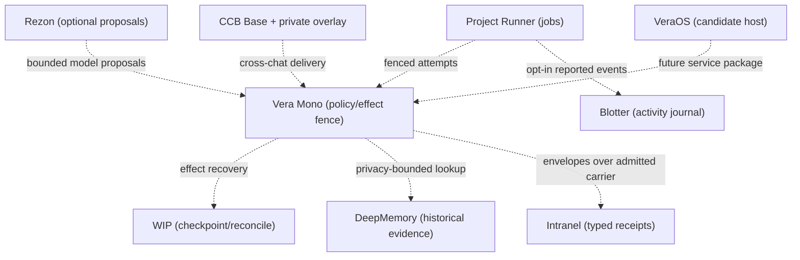

# Essential Vera AI integration boundary — 2026-10-25

Coordination: `bt2_fixes&integrates_all_veras_bullshit`; prior bridge: `bt2_live_coordination_intranel`.
Status: **reviewable source architecture / partial live component probes**. This file does not certify an installed, autonomous, learning, or cross-host Vera system.

## Explicit selection

`vera-mono` is the **self-contained runtime and effect-policy center**. The other repositories have *bounded optional interfaces*, not implicit runtime import dependencies.

| Repository, pinned observed `main` | Valid responsibility | Proven boundary / missing runtime |
| --- | --- | --- |
| [vera-mono](https://github.com/thebrazenbeard/vera-mono) `64c4a756` | Core orchestrated Vera implementation, local packages, policy/effect fence, experimental bounded learning | Main is not the successor experimental journal patch; no installed selected Vera process qualification |
| [vera](https://github.com/thebrazenbeard/vera) `5f2932a7` | Cross-cutting architecture and source/evidence | Security PR222 merged and editor source checked; not live resident |
| [rezon](https://github.com/thebrazenbeard/rezon) `d27da3ca` | Optional heterogeneous *external* multi-model deliberation; contributions are candidates | Three physical local model calls independently completed, but no authenticated persisted multi-host hearing. PR119/121 remain draft/stacked |
| [intranel](https://github.com/thebrazenbeard/intranel) `25a2332a` | Typed intent, identity, constraints, and receipts over admitted transport | Source host-peer candidate `cf694767` passes tests; actual authenticated SSH key/account-to-peer binding and installation missing |
| [ccb-core](https://github.com/thebrazenbeard/ccb-core) `9d53ce2e` | Reusable durable bus/Radar transport | Read-only Intranel codec candidate `42b6f69c` source-only; provider HTTP503 delivery not recovered |
| [chat-communication-bus](https://github.com/thebrazenbeard/chat-communication-bus) | Private deployment overlays, topology, lane governance and receipts | Separate private runtime evidence; cannot treat GitHub comments as authenticated bus delivery |
| [project-runner](https://github.com/thebrazenbeard/project-runner) `e0ef7ebd` | Work intake, exact-head planning/ownership, fenced attempts | Opt-in journal→Blotter exporter in development; no globally qualified scheduler |
| [wip](https://github.com/thebrazenbeard/wip) `13185463` | Checkpointing, crash reconciliation, ambiguous effects | Not a second dispatcher; no bound active resident instance |
| [blotter](https://github.com/thebrazenbeard/blotter) `2493b354` | Append-only activity observation; not messaging or authority | An authenticated Lappy actor posted seq1359–1361 and read back; not a deployed cross-machine task bus |
| [deepmemorystorage](https://github.com/thebrazenbeard/deepmemorystorage) `63edbc51` | Historical/provenance evidence retrieval through VeraMono privacy adapter | Never current instructions, live identity, or unexamined self-modification |
| [lgcm](https://github.com/thebrazenbeard/lgcm) `6bc748f3` | Continual-learning research and falsifiable evaluation | Experimental; no demonstrated live model-weight update |
| [vera-os](https://github.com/thebrazenbeard/vera-os) `0e35d758` | Prospective native Linux service/host package | Architecture-stage; do not call installed VeraOS |
| [vera-control-plane](https://github.com/thebrazenbeard/vera-control-plane) `0654b4a6` | Authority, asset custody and release/evidence governance | No implied standing permission to enroll credentials or deploy |

The `packages/rezon` local to VeraMono and external `rezon` are not automatically interchangeable. Explicit version/adaptor validation is required. Likewise `intranel` envelopes do not establish trust; the authenticated carrier does.

## Source and intended operational graph

**Dashed edges mean intended / source-stage interoperation, not physically proven end-to-end delivery.** A strong integration edge requires two-sided readback, persistent receipt, duplicate/replay/ambiguous-effect tests, and pinned exact source/install identity. Shared repository ownership is not an interface.

## Four highest-leverage qualification gates

1. **Credential and transport trust:** Owner-local Rezon enrollment per its existing explicit security contract, then read-only status; never enroll via ChatGPT-connected remote shells. For Intranel, trusted OpenSSH server-observed client key/account and pinned server host key must bind `ObservedPeer`. Test peer forgery, lost ACK, collision and restart.
2. **Real model hearing:** Verified Rezon gateway readback, all four expected roles `lappy`, `malaphor`, `vn1`, `vn2`, fresh authenticated worker registrations, contribution persistence, evaluator custody, and a final hearing receipt. Independent local Ollama/llama-server generation is lower-level evidence only.
3. **Learning without claim inflation:** VeraMono method-journal candidate `e3f23b58` fixed six hostile orphan-role bypasses, remains `execution_state=UNKNOWN`, `authorization_effect=NONE`, source-only. Compare learned candidate against prior baseline and negative transfer before any promotion. DriftGuard may gate an exact-head regression; F.U.C.K.U.P. may record corrections; neither constitutes weight learning.
4. **Durable coordination:** Project Runner must own task leases; WIP journals effects/recovery; private CCB delivers addressed messages with receipts; Blotter records events; DeepMemory stores historical provenance. Prove source→build→install→runtime→effect separately and recover after crash with duplicate identities stable.

## Deliberate isolation

No automatic production dependency on `noema`, `god-brain`, `hc-brain`, `transcendence`, `meso-crct`, `orgasm`, `self`, or other speculative cognition/identity repositories. They can contribute reviewable bounded experiments, not authority or installed resident identity by association. `noema/main` remains unsafe to editor-open until its concealed folder-open task payload containment is merged; a tested isolated candidate exists.

Unrelated industrial, media/NAS, literary, gaming, finance and research repos should remain outside this AI runtime deployment graph unless an actual needed interface is specified and proven.

## Reproducibility and ownership

- Exact live `main` SHAs above were read from GitHub branch APIs on 2026-10-25. Branch candidate commits, tests, CI, provider/host readbacks, owners and blockers appear in [the integration ledger](ECOSYSTEM_INTEGRATION_LEDGER_20261024.md).
- Repository-local CLA, draft PR, legal provenance, E0 governance and credential policies override a generic merge preference. No first-person CLA statement may be attributed to Patrick without his own authorized acceptance.
- The acceptance condition is **a real resident Vera process crossing source-pinned reasoning, authenticated transport, durable recovery and independently read-back effect**. This has **not** been observed at the date of this file.
